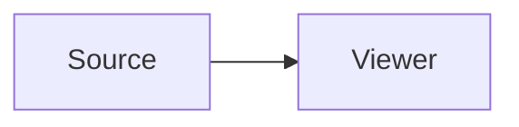

# Fixture document

A [safe link](https://example.com) and a [script link](javascript:alert(1)).

<script>window.__mdPwned = true</script>

| Part | Qty |
| --- | --- |
| R1 | 1 |

- [x] done
- [ ] todo

```ts
const greeting: string = 'hello';
```


